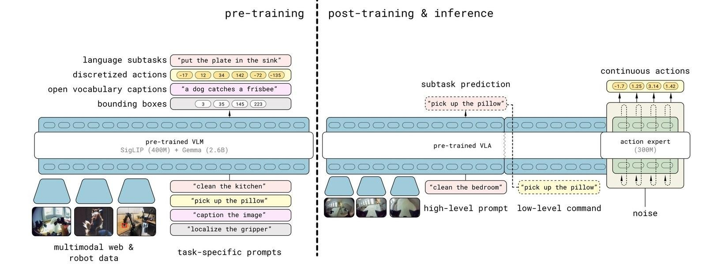
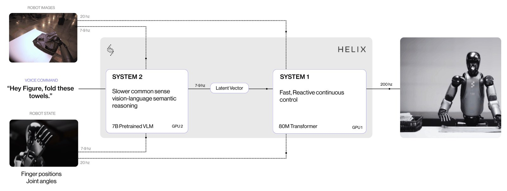
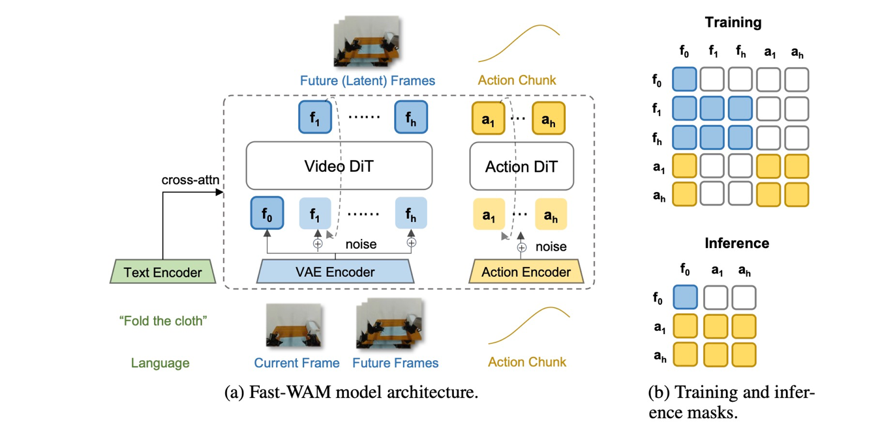
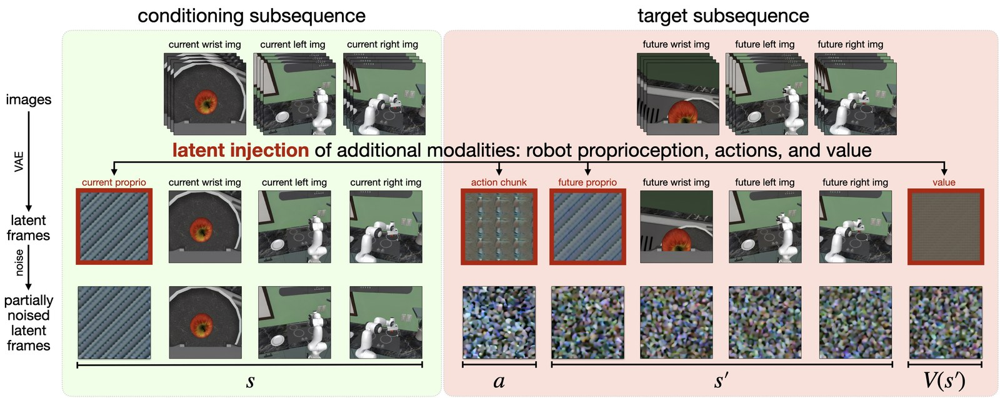
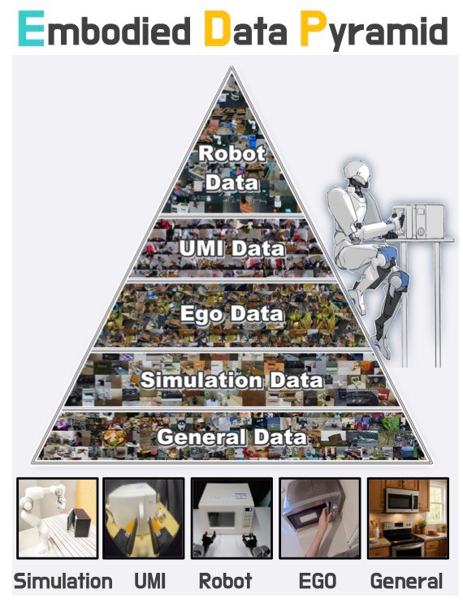
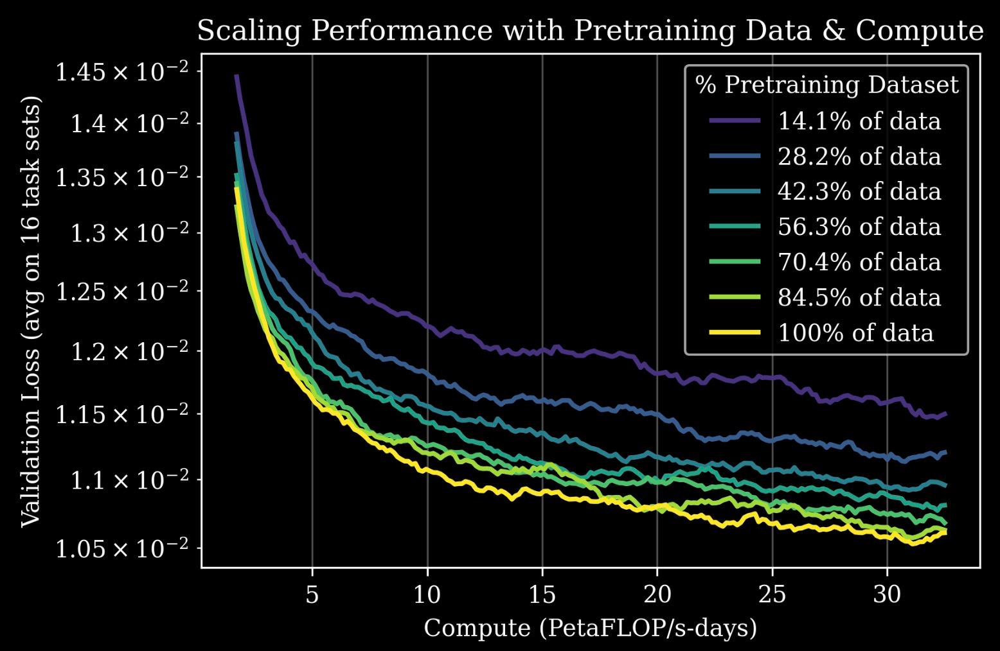
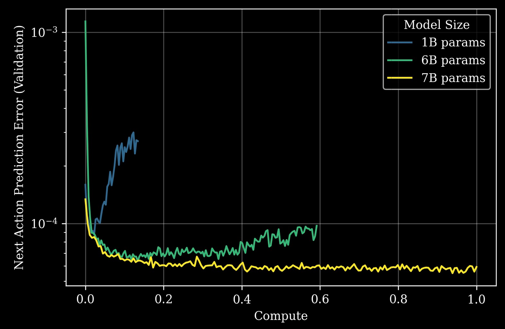
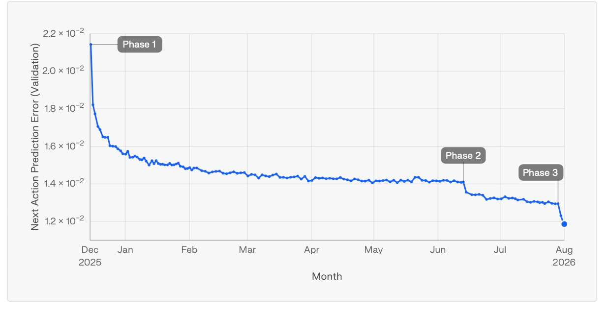
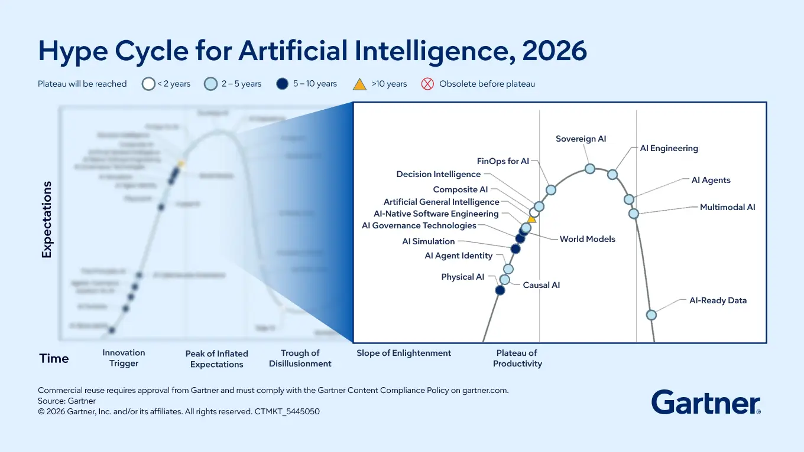

In three years, embodied foundation models went from discrete action tokens on top of a VLM, to flow-matching action experts, to world action models built on video generation backbones, and now to hybrids of the two. This post walks through that evolution: Vision-Language-Action (VLA) models, World Action Models (WAM), and recent attempts to unify them (UAM). It then covers embodied data and scaling laws, gives a quick tour of the latest models, and closes with some thoughts on where the industry stands.

## Evolution of VLA

### From RT-2 to Action Experts

**RT-2** ([Brohan et al. 2023](https://arxiv.org/abs/2307.15818)), released by Google in 2023, formally introduced the concept of VLA. It takes a pretrained VLM as the backbone, encodes robot actions as discrete tokens that share one vocabulary with text tokens, and fine-tunes on robot trajectory data, so that a single Transformer processes images, language, and actions. RT-2 gave a first look at the potential of the VLA paradigm, and **OpenVLA** ([Kim et al. 2024](https://arxiv.org/abs/2406.09246)), an open-source counterpart, pushed research in this direction forward. However, because its actions are discrete tokens, the resulting motion is not smooth.

**Diffusion Policy** ([Chi et al. 2023](https://arxiv.org/abs/2303.04137)) is a VA (vision-action) model without language, but it showed what diffusion models can do for action generation. **Action Chunking with Transformers** (ACT; [Zhao et al. 2023](https://arxiv.org/abs/2304.13705)) addresses the large compounding error of single-step behavior cloning (BC) by predicting a whole chunk of the next $$k$$ actions at once, which suppresses error accumulation. **Octo** ([Octo Model Team et al. 2024](https://arxiv.org/abs/2405.12213)) brought both the diffusion action head and action chunking into a VLA.

### Data: Open X-Embodiment

Another problem with RT-2 was its small training set, which limited it to simple tasks. Google and many partner labs then released **Open X-Embodiment** (OXE; [Open X-Embodiment Collaboration 2023](https://arxiv.org/abs/2310.08864)), an open dataset of over one million trajectories and the largest real-robot dataset at the time. RT-2-X, pretrained on this cross-embodiment dataset, roughly tripled the performance of the original RT-2 on emergent skills. OXE is still the largest open-source real-robot dataset. **AgiBot World** ([AgiBot World Contributors 2025](https://arxiv.org/abs/2503.06669)), later open-sourced by AgiBot, is close in scale, but its data comes from a single robot model.

### The π Series

The most influential and most widely used open models in the industry today are the π series from Physical Intelligence (PI). Their version history doubles as a summary of how VLA models developed over the past two years:

| Model | Release | Focus | Key techniques |
|---|---|---|---|
| π0 ([Black et al. 2024](https://arxiv.org/abs/2410.24164)) | 2024.10 | Capability: first to complete complex tasks such as folding laundry and assembling boxes | Cross-embodiment training + flow matching (FM) action expert |
| π0.5 ([Physical Intelligence 2025](https://arxiv.org/abs/2504.16054)) | 2025.04 | Generalization: open-world generalization | Larger backbone + FAST + Hi Robot |
| π\*0.6 ([Physical Intelligence 2025](https://arxiv.org/abs/2511.14759)) | 2025.11 | Performance and robustness | RECAP + RTC + KI |
| π0.7 ([Physical Intelligence 2026](https://arxiv.org/abs/2604.15483)) | 2026.03 | Steerability | MEM + WM + prompt engineering |

<figure>
  
  <figcaption>Fig. 1. Overview of π0.5: pre-training on mixed web and robot data with discrete action tokens, then post-training with a flow-matching action expert that predicts a high-level subtask first and continuous actions second. (Image source: <a href="https://arxiv.org/abs/2504.16054">Physical Intelligence 2025</a>)</figcaption>
</figure>

Many of these techniques, such as the FM action head and RTC, have become standard parts of the VLA recipe. PI relies mainly on real-robot data: π0 was trained on more than 10,000 hours, of which 9.1% came from open datasets such as OXE. PI also has an interesting collaboration with Stanford, **AIR-VLA** ([Sun et al. 2026](https://arxiv.org/abs/2601.21602)), which uses a small amount of data to control an indoor drone that flies and grasps objects, a good demonstration of strong generalization.

### Hierarchical Systems

Many humanoid robots use a hierarchical fast–slow (dual-system) or three-system design, with System 2 handling high-level semantics and System 1/0 handling real-time execution. Examples include **GR00T N1** ([NVIDIA 2025](https://arxiv.org/abs/2503.14734)) and **Helix** ([Figure AI 2025](https://www.figure.ai/helix)). By comparison, Hi Robot mainly decomposes a text task into subtasks. Helix is the system from Figure, a leading US embodied-AI startup. Figure's data is mostly egocentric (ego) human data, and the company launched [Project Index](https://www.figure.ai/index-app) to collect real-world task data through crowdsourcing: users record tasks in homes, warehouses, restaurants and other settings with a phone or a head-mounted device, and Figure filters, deduplicates and annotates the videos and turns them into robot training data.

<figure>
  
  <figcaption>Fig. 2. Helix: a 7B VLM (System 2) runs at 7–9 Hz for semantic reasoning and passes a latent vector to an 80M Transformer (System 1) that outputs continuous control at 200 Hz. (Image source: <a href="https://www.figure.ai/helix">Figure AI 2025</a>)</figcaption>
</figure>

### Reinforcement Learning

A short note on RL. VLA training today closely follows the LLM recipe, and getting to fine-grained manipulation, let alone beyond human level, requires reinforcement learning. PI's RECAP and RTC improve task success rate and fine-grained manipulation respectively, but PI does not fine-tune actions directly with algorithms like PPO or GRPO. The reason is the flow-matching action output: diffusion and flow models cannot give $$\log \pi$$ directly, which makes them harder to use for RL than regression heads. **LaST0** ([Liu et al. 2026](https://arxiv.org/abs/2601.05248)) uses an FM action head, while **LaST-R1** ([Chen et al. 2026](https://arxiv.org/abs/2604.28192)) went back to a regression action head, again because LaST-R1 is trained with RL. Some work does compute $$\log \pi$$ for diffusion and flow models, such as **DPPO** ([Ren et al. 2024](https://arxiv.org/abs/2409.00588)) and **FPO** ([McAllister et al. 2025](https://arxiv.org/abs/2507.21053)), but each has its own limitations.

VLAs are built on VLMs and inherit the strong generalization and semantic understanding of LLMs. Their understanding of image input, however, is fairly static, which leaves them weak at understanding dynamic physics. Starting in 2026, models built on video generation backbones, known as WAMs, began to appear in large numbers.

## World Action Models

Earlier work such as **UniPi** ([Du et al. 2023](https://arxiv.org/abs/2302.00111)) generated future frames with video diffusion and then produced robot actions with an inverse dynamics model (IDM), showing that internet-scale video models can transfer physical priors to robots. In February 2026, NVIDIA released **DreamZero** ([Ye et al. 2026](https://arxiv.org/abs/2602.15922)), which formally introduced the name World Action Models (WAM), and WAM research took off. By how they model video prediction and action generation, WAMs fall into the three categories below. Here I only cover WAMs in the narrow sense, i.e. models built on a video generation model.

### Shared Attention with Specialized Experts (MoT-style)

- **Efficient-WAM** ([Li et al. 2026](https://arxiv.org/abs/2606.10040)): high-fidelity full videos are unnecessary. Sparse, low-resolution dynamic latents are enough to provide the benefit of looking ahead, at a cost far below a standard IDM.
- **Fast-WAM** ([Yuan et al. 2026](https://arxiv.org/abs/2603.16666)): shows that during training, the KV cache the video DiT computes from the encoded current frame already implicitly contains the upcoming physical dynamics. At deployment, therefore, only that KV cache is needed. The model never decodes future frames and then solves for actions with inverse dynamics, which cuts latency substantially. The base model is Wan2.2-5B with a MoT architecture.
  - **Faster-WAM** ([Ma et al. 2026](https://arxiv.org/abs/2608.02365)) replaces MoT with DoT (Dock of Transformers), also on Wan2.2-5B.
- **Motus** ([Bi et al. 2025](https://arxiv.org/abs/2512.13030)): tri-model joint attention across a video foundation model (Wan2.2-5B), an understanding expert (whose input is the last-layer tokens of Qwen3-VL-2B), and an action expert (a Transformer with the same depth as Wan).

<figure>
  
  <figcaption>Fig. 3. Fast-WAM architecture and the attention masks used in training and inference. Future frames are only denoised during training; at inference, actions attend to the current frame alone. (Image source: <a href="https://arxiv.org/abs/2603.16666">Yuan et al. 2026</a>)</figcaption>
</figure>

### Single Backbone

- **DreamZero** ([Ye et al. 2026](https://arxiv.org/abs/2602.15922)): turns a video generation diffusion model (Wan2.1-I2V-14B-480P) into a WAM that predicts both video and actions. Without fine-tuning on any robot action data (zero-shot), it gets close to state-of-the-art VLAs in closed-loop simulation; after fine-tuning on a small amount of action data, it clearly outperforms existing VLAs. The key is the implicit inverse dynamics of joint video–action denoising. When the DiT denoises video and actions together, the action decoder effectively acts as an inverse dynamics model: it "reads" the world dynamics predicted inside the DiT's representations and infers actions from them. This is much more efficient than generating a full video first and inferring actions afterwards.
- **Cosmos Policy** ([Kim et al. 2026](https://arxiv.org/abs/2601.16163)): starts from the pretrained Cosmos-Predict2 video diffusion backbone and encodes every non-image modality (proprioception, actions, value) as a placeholder latent frame inserted into the video latent sequence, so that all modalities are modeled jointly in the diffusion latent space.

<figure>
  
  <figcaption>Fig. 4. Latent frame injection in Cosmos Policy: proprioception, the action chunk and the value are written into placeholder latent frames alongside the camera views, and the model denoises the target subsequence conditioned on the current state. (Image source: <a href="https://arxiv.org/abs/2601.16163">Kim et al. 2026</a>)</figcaption>
</figure>

### IDM-style

- **UniPi** ([Du et al. 2023](https://arxiv.org/abs/2302.00111)) / **LingBot-VA** ([Li et al. 2026](https://arxiv.org/abs/2601.21998)): the target variable $$g$$ is the next observation $$o_{t+1}$$ or a future observation $$o_{t+k}$$ several steps ahead.

### Limitations

WAMs have a natural advantage in understanding dynamic physics (robustness), but their drawbacks are just as clear. First, the models are too large to run on the robot itself, and real-time control usually takes high-performance compute plus system design and acceleration tricks. Second, their real-robot performance is often underwhelming and shows no clear advantage over VLAs. And as harnesses mature, it is still unclear whether WAMs are a good fit for connecting with agentic LLMs.

WAMs give up the strong L (language) of VLAs in the hope of getting dynamic physical properties from pixel-based video generation. I don't think pixel-based modeling is required. Finding more efficient representations and generation methods is a major research direction for WAMs; recent examples include **JEPA-WAM** ([Lin et al. 2026](https://arxiv.org/abs/2608.09381)), Faster-WAM, and the one-step video generation in **Dyna-2** ([Dyna Robotics](https://www.dyna.co/dyna-2)).

## Unified Action Models

With the strengths and weaknesses of VLA and WAM laid out, **UAM** (Unified Action Model; [Zhang et al. 2026](https://arxiv.org/abs/2605.15735)) tries to merge the two directions. It treats the VLA as the ventral stream and adds a dorsal stream to improve dynamic understanding, following the classic two-streams hypothesis of vision from neuroscience:

1. **Ventral stream (the "what" pathway)**: semantic recognition, object cognition and language binding. It tells what an object is, its color, category and text, and what the scene means. This corresponds to the general image–text understanding of a VLM.
2. **Dorsal stream (the "where/how" pathway)**: spatial localization, motion perception, visuomotor coupling, scene dynamics, and grasping. It tells where an object is, how far away it is, how to reach for and grasp it, which way it is moving, and whether a collision is coming. It exists to serve limb control.

UAM is not yet an industry-wide concept, and similar ideas go by other names, such as **WLA** (World-Language-Action; [Yang et al. 2026](https://arxiv.org/abs/2606.05979)). The broad direction is shared, though: strengthen the dynamic representation of VLA models by combining them with world models (WM). For example, π0.7 uses a WM to generate a goal image as a prompt for the VLA, which can arguably be seen as a generalized IDM-style WAM. There is a lot of excellent work in this direction, including **VLA-JEPA** ([Sun et al. 2026](https://arxiv.org/abs/2602.10098)), the LaST series ([Liu et al. 2026](https://arxiv.org/abs/2601.05248); [Chen et al. 2026](https://arxiv.org/abs/2604.28192)), and **InternVLA-A1.5** ([Ma et al. 2026](https://arxiv.org/abs/2607.04988)).

## Embodied Data and Scaling Laws

### The Data Pyramid

Data scarcity is one of the hardest problems in embodied AI: there is no natural internet-scale data source like the one LLMs train on. Embodied data has grown from OXE's million trajectories in 2023 to nearly a million hours at today's leading companies, but it is still several orders of magnitude smaller than LLM training data. This is considered one of the main reasons the "GPT-3 moment" of embodied AI has not arrived yet. Data paradigms are also far from settled and still changing quickly. In 2022, Yuke Zhu first proposed the idea of a data pyramid that sorts data into tiers by type; it has since been extended, see the survey by [Ye et al. (2026)](https://arxiv.org/abs/2607.24744) for details.

<figure>
  
  <figcaption>Fig. 5. The embodied data pyramid. From top to bottom: robot data, UMI data, ego data, simulation data, and general data, roughly in decreasing order of collection cost and increasing order of volume. (Image source: <a href="https://arxiv.org/abs/2607.24744">Ye et al. 2026</a>)</figcaption>
</figure>

- **Real-robot data**: expensive and slow to collect. Post-training, at least, still requires real-robot data for the target embodiment and task. Work such as Dyna-2 claims zero-shot transfer to new robots and new tasks, but with poor success rates. Real-robot data also suffers from missing force feedback, latency, and occluded visual observations. Since 2026, the industry has started replacing real-robot data with UMI and ego data in pretraining.
- **UMI data**: moderate collection cost. Only the end-effector (EEF) pose is available. Data from the same morphology can be used directly; otherwise it must be retargeted to the target morphology.
- **Ego data**: low collection cost, and widely valued across the industry since **EgoScale** ([Zheng et al. 2026](https://arxiv.org/abs/2602.16710)). Only the EEF is available and retargeting is required, but current retargeting methods are generally simple and introduce errors.

Some work, such as **Qwen-RobotManip** ([Yuan et al. 2026](https://arxiv.org/abs/2606.17846)), solves inverse kinematics to retarget data across robots of different morphologies and recover joint-space data, but this is not mainstream yet.

### Scaling Laws

As with models, there is no agreed recipe yet for using and mixing different types of embodied data. As mentioned above, PI takes the real-robot route and Figure the ego route, while Generalist, another leading US embodied company, chose UMI. **GEN-0** ([Generalist AI 2025](https://generalistai.com/blog/gen-0)), released in November 2025, was the first to demonstrate scaling laws for embodied AI, using 270,000 hours of data. This year, as data piled up, several companies have each shown scaling laws between data and performance. However, the 7B phase-transition point reported by GEN-0 is specific to its own model and has not become a consensus for model design at the scale of hundreds of thousands or millions of hours. Beyond scaling laws, GEN-0's Harmonic Reasoning is another interesting design: it lets the GEN series run large models for real-time manipulation without fast–slow systems or RTC.

<figure>
  

    
    
  

  <figcaption>Fig. 6. GEN-0 scaling results. Left: validation loss keeps falling with more pretraining data and compute. Right: at this data scale, the 1B and 6B models eventually get worse while the 7B model keeps improving. (Image source: <a href="https://generalistai.com/blog/gen-0">Generalist AI 2025</a>)</figcaption>
</figure>

## Recent Embodied Models at a Glance

### In-Context Learning

- **Skild S1** ([Skild AI](https://skild.ai/blogs/s1)): about 100,000 hours of mixed data, designed specifically for in-context learning (ICL). Video demonstrations completely replace text instructions.
- **Zero-WAM** ([Zhou et al. 2026](https://arxiv.org/abs/2608.26103)): accepts both text instructions and human demonstration videos as task prompts.
- **GEN-1.5** ([Generalist AI 2026](https://generalistai.com/blog/gen-1.5)): a continued-training version of **GEN-1** ([Generalist AI](https://generalistai.com/blog/gen-1)) on more than 500,000 hours of UMI data. Unlike π0.5 and similar models, which mostly use the current frame or a very short observation history, it supports up to 30 seconds of context, including vision, proprioception and actions. It has no special ICL design, but ICL ability emerged as data and training time grew; it has been trained continuously for 8 months and is still improving.

<figure>
  
  <figcaption>Fig. 7. GEN-1.5 has been pretraining for over 8 months, and its next-action prediction error on a held-out validation set keeps dropping across 3 training phases. (Image source: <a href="https://generalistai.com/blog/gen-1.5">Generalist AI 2026</a>)</figcaption>
</figure>

### Other Notable Models

- **Isaac 0.5** ([Perceptron](https://www.perceptron.inc/blog/introducing-isaac-0-5)): fixes the data mix at general : egocentric : UMI = 8 : 3 : 3. Scaling general video from 1,000 hours to 1,000,000 hours cuts the teleoperated robot data needed to reach the same offline action loss from 5,884 hours to 28 hours, a 210.3× reduction. Pure video data helps here because of an in-house future-percept self-supervised objective: instead of reconstructing pixels, the model predicts task-relevant semantic states of future frames. In effect, it first learns perception well from large amounts of video, so that downstream action learning becomes much lighter.
- **noe-0** ([Noematrix](https://lab.noematrix.ai/blog/1-noe-0-research-preview/)): a WAM trained on about 100,000 hours of UMI data; post-training also needs no real-robot data.
- **OM-1** ([Reward AI](https://www.rewardai.com/blog/OM-1/)): paired with Omnibody Hand, a 7-DoF wearable glove, it records vision, touch and hand pose in sync and needs no hardware-specific fine-tuning. According to the company, learning a new task usually takes less than 30 minutes of human demonstration data. Data scale and model details have not been disclosed.
- **Dyna-2** ([Dyna Robotics](https://www.dyna.co/dyna-2)): scaling laws for a WAM trained on 1,000,000 hours of ego data; it is clearly stronger than the first-generation VLA, Dyna-1, in head-to-head comparison. (I have quite a few questions about this work. For example, the conclusions of its three training recipes contradict those of other models without explanation. If you know more, I would be glad to discuss.)

### Harness

- **Harness VLA** ([Zhang et al. 2026](https://arxiv.org/abs/2607.08448)): relies on a strong LLM for judgment and scheduling.
- **Zetta** ([Ding et al. 2026](https://arxiv.org/abs/2608.16590)): relies on privileged information from simulation that is not available on a real robot.

### Frontier LLMs+

- **GPT-6** ([Galbot Team 2026](https://arxiv.org/abs/2609.38537)): robot data was added during training, and together with the model's general strength this has made it very popular in the embodied community. It has strong spatial understanding and judgment, but fine-grained manipulation, inference cost and latency remain bottlenecks.
- **Jev** ([Jev](https://jevmodel.org/)): good at decision making, but it does not accept multimodal input, so it cannot serve directly as an embodied foundation model.

## Industry and Outlook

Embodied AI is clearly still at an early stage. Data and models are both developing fast and the paradigms are diverse, but the field is still working on ability, i.e. what a robot *can* do, and there is a huge gap between "can do" and "usable". ToB applications need extremely stable reliability, safety, and adaptability to high cycle rates; industrial use usually requires four or even five nines of success rate, and there are wide gaps on all three fronts today. Yet the direction is inevitable. On one hand, we need to lower expectations, stay patient, and see less hype and fewer false claims in the industry. On the other hand, hardware, models and data all need to move forward together.

<figure>
  
  <figcaption>Fig. 8. Gartner Hype Cycle for Artificial Intelligence, 2026. Physical AI and world models are both still climbing the innovation trigger, and both are expected to take 5–10 years to reach the plateau of productivity. (Image source: <a href="https://www.gartner.com/en/articles/hype-cycle-for-artificial-intelligence">Gartner 2026</a>)</figcaption>
</figure>

On the model side, as discussed above, how to represent WAMs more efficiently and how to get more dynamic representation out of VLAs are both worth studying. Taking a step back, the names matter less, as Generalist argues in its blog post [Going Beyond World Models & VLAs](https://generalistai.com/blog/beyond-world-models). That GEN-1.5 acquired ICL without a dedicated design must have something to do with its design paradigm. The industry still lacks embodied-native models with multimodal input and multimodal output. Works that present themselves as physical foundation models, such as **PhysBrain 1.5** ([DeepCybo Team 2026](https://arxiv.org/abs/2609.14973)), **HY-Embodied-0.5** ([Tencent Robotics X 2026](https://arxiv.org/abs/2604.07430)) and **Hy-Embodied-VLM-1.0** ([Wang et al. 2026](https://arxiv.org/abs/2607.12894)), all extend a VLM backbone with spatial perception and spatial reasoning as the core optimization targets, and remain far from embodied-native foundation models.



## References

[1] Brohan, et al. ["RT-2: Vision-Language-Action Models Transfer Web Knowledge to Robotic Control."](https://arxiv.org/abs/2307.15818) CoRL 2023.

[2] Kim, et al. ["OpenVLA: An Open-Source Vision-Language-Action Model."](https://arxiv.org/abs/2406.09246) CoRL 2024.

[3] Chi, et al. ["Diffusion Policy: Visuomotor Policy Learning via Action Diffusion."](https://arxiv.org/abs/2303.04137) RSS 2023.

[4] Zhao, et al. ["Learning Fine-Grained Bimanual Manipulation with Low-Cost Hardware."](https://arxiv.org/abs/2304.13705) RSS 2023.

[5] Octo Model Team, et al. ["Octo: An Open-Source Generalist Robot Policy."](https://arxiv.org/abs/2405.12213) RSS 2024.

[6] Open X-Embodiment Collaboration. ["Open X-Embodiment: Robotic Learning Datasets and RT-X Models."](https://arxiv.org/abs/2310.08864) ICRA 2024.

[7] AgiBot World Contributors. ["AgiBot World Colosseo: A Large-scale Manipulation Platform for Scalable and Intelligent Embodied Systems."](https://arxiv.org/abs/2503.06669) arXiv preprint arXiv:2503.06669, 2025.

[8] Black, et al. ["π0: A Vision-Language-Action Flow Model for General Robot Control."](https://arxiv.org/abs/2410.24164) arXiv preprint arXiv:2410.24164, 2024.

[9] Physical Intelligence. ["π0.5: a Vision-Language-Action Model with Open-World Generalization."](https://arxiv.org/abs/2504.16054) arXiv preprint arXiv:2504.16054, 2025.

[10] Physical Intelligence. ["π\*0.6: a VLA That Learns From Experience."](https://arxiv.org/abs/2511.14759) arXiv preprint arXiv:2511.14759, 2025.

[11] Physical Intelligence. ["π0.7: a Steerable Generalist Robotic Foundation Model with Emergent Capabilities."](https://arxiv.org/abs/2604.15483) arXiv preprint arXiv:2604.15483, 2026.

[12] Sun, et al. ["AIR-VLA: Vision-Language-Action Systems for Aerial Manipulation."](https://arxiv.org/abs/2601.21602) arXiv preprint arXiv:2601.21602, 2026.

[13] NVIDIA. ["GR00T N1: An Open Foundation Model for Generalist Humanoid Robots."](https://arxiv.org/abs/2503.14734) arXiv preprint arXiv:2503.14734, 2025.

[14] Figure AI. ["Helix: A Vision-Language-Action Model for Generalist Humanoid Control."](https://www.figure.ai/helix) Figure Blog, 2025.

[15] Figure AI. ["Project Index."](https://www.figure.ai/index-app) Figure website.

[16] Liu, et al. ["LaST0: Latent Spatio-Temporal Chain-of-Thought for Robotic Vision-Language-Action Model."](https://arxiv.org/abs/2601.05248) arXiv preprint arXiv:2601.05248, 2026.

[17] Chen, et al. ["LaST-R1: Reinforcing Robotic Manipulation via Adaptive Physical Latent Reasoning."](https://arxiv.org/abs/2604.28192) arXiv preprint arXiv:2604.28192, 2026.

[18] Ren, et al. ["Diffusion Policy Policy Optimization."](https://arxiv.org/abs/2409.00588) ICLR 2025.

[19] McAllister, et al. ["Flow Matching Policy Gradients."](https://arxiv.org/abs/2507.21053) arXiv preprint arXiv:2507.21053, 2025.

[20] Du, et al. ["Learning Universal Policies via Text-Guided Video Generation."](https://arxiv.org/abs/2302.00111) NeurIPS 2023.

[21] Ye, et al. ["World Action Models are Zero-shot Policies."](https://arxiv.org/abs/2602.15922) arXiv preprint arXiv:2602.15922, 2026.

[22] Li, et al. ["Efficient-WAM: A 1B-Parameter World-Action Model with Low-Cost Future Imagination."](https://arxiv.org/abs/2606.10040) arXiv preprint arXiv:2606.10040, 2026.

[23] Yuan, et al. ["Fast-WAM: Do World Action Models Need Test-time Future Imagination?"](https://arxiv.org/abs/2603.16666) arXiv preprint arXiv:2603.16666, 2026.

[24] Ma, et al. ["Faster-WAM: Do World Action Models Need Deep Action Modules?"](https://arxiv.org/abs/2608.02365) arXiv preprint arXiv:2608.02365, 2026.

[25] Bi, et al. ["Motus: A Unified Latent Action World Model."](https://arxiv.org/abs/2512.13030) arXiv preprint arXiv:2512.13030, 2025.

[26] Kim, et al. ["Cosmos Policy: Fine-Tuning Video Models for Visuomotor Control and Planning."](https://arxiv.org/abs/2601.16163) arXiv preprint arXiv:2601.16163, 2026.

[27] Li, et al. ["LingBot-VA: Causal World Modeling for Robot Control."](https://arxiv.org/abs/2601.21998) arXiv preprint arXiv:2601.21998, 2026.

[28] Lin, et al. ["JEPA-WAM: Learning Vision-Language-Action Policies with Joint-Embedding World Modeling."](https://arxiv.org/abs/2608.09381) arXiv preprint arXiv:2608.09381, 2026.

[29] Dyna Robotics. ["Dyna-2."](https://www.dyna.co/dyna-2) Dyna website.

[30] Zhang, et al. ["UAM: A Dual-Stream Perspective on Forgetting in VLA Training."](https://arxiv.org/abs/2605.15735) arXiv preprint arXiv:2605.15735, 2026.

[31] Yang, et al. ["World-Language-Action Model for Unified World Modeling, Language Reasoning, and Action Synthesis."](https://arxiv.org/abs/2606.05979) arXiv preprint arXiv:2606.05979, 2026.

[32] Sun, et al. ["VLA-JEPA: Enhancing Vision-Language-Action Model with Latent World Model."](https://arxiv.org/abs/2602.10098) arXiv preprint arXiv:2602.10098, 2026.

[33] Ma, et al. ["InternVLA-A1.5: Unifying Understanding, Latent Foresight, and Action for Compositional Generalization."](https://arxiv.org/abs/2607.04988) arXiv preprint arXiv:2607.04988, 2026.

[34] Ye, et al. ["Data Pyramid for Embodied Manipulation: A Survey."](https://arxiv.org/abs/2607.24744) arXiv preprint arXiv:2607.24744, 2026.

[35] Zheng, et al. ["EgoScale: Scaling Dexterous Manipulation with Diverse Egocentric Human Data."](https://arxiv.org/abs/2602.16710) arXiv preprint arXiv:2602.16710, 2026.

[36] Yuan, et al. ["Qwen-RobotManip Technical Report: Alignment Unlocks Scale for Robotic Manipulation Foundation Models."](https://arxiv.org/abs/2606.17846) arXiv preprint arXiv:2606.17846, 2026.

[37] Generalist AI. ["GEN-0."](https://generalistai.com/blog/gen-0) Generalist Blog, 2025.

[38] Skild AI. ["S1."](https://skild.ai/blogs/s1) Skild Blog.

[39] Zhou, et al. ["Zero-WAM: In-Context World-Action Modeling from Human Videos for Open-Ended Task Generalization."](https://arxiv.org/abs/2608.26103) arXiv preprint arXiv:2608.26103, 2026.

[40] Generalist AI. ["GEN-1.5."](https://generalistai.com/blog/gen-1.5) Generalist Blog, 2026.

[41] Generalist AI. ["GEN-1."](https://generalistai.com/blog/gen-1) Generalist Blog.

[42] Perceptron. ["Introducing Isaac 0.5."](https://www.perceptron.inc/blog/introducing-isaac-0-5) Perceptron Blog.

[43] Noematrix. ["noe-0 Research Preview."](https://lab.noematrix.ai/blog/1-noe-0-research-preview/) Noematrix Lab Blog.

[44] Reward AI. ["OM-1."](https://www.rewardai.com/blog/OM-1/) Reward AI Blog.

[45] Zhang, et al. ["Harness VLA: Steering Frozen VLAs into Reliable Manipulation Primitives via Memory-Guided Agents."](https://arxiv.org/abs/2607.08448) arXiv preprint arXiv:2607.08448, 2026.

[46] Ding, et al. ["Zetta ζ: An Efficient Closed-Loop Embodied Harness for Self-Evolving Physical Intelligence."](https://arxiv.org/abs/2608.16590) arXiv preprint arXiv:2608.16590, 2026.

[47] Galbot Team. ["Systematically Exploring the Capabilities of GPT-6 Astra as Embodied Policies."](https://arxiv.org/abs/2609.38537) arXiv preprint arXiv:2609.38537, 2026.

[48] Jev. [jevmodel.org](https://jevmodel.org/).

[49] Generalist AI. ["Going Beyond World Models & VLAs."](https://generalistai.com/blog/beyond-world-models) Generalist Blog.

[50] DeepCybo Team. ["PhysBrain 1.5: From Vision-Language Models to Physical Foundation Models."](https://arxiv.org/abs/2609.14973) arXiv preprint arXiv:2609.14973, 2026.

[51] Tencent Robotics X. ["HY-Embodied-0.5: Embodied Foundation Models for Real-World Agents."](https://arxiv.org/abs/2604.07430) arXiv preprint arXiv:2604.07430, 2026.

[52] Wang, et al. ["Hy-Embodied-VLM-1.0: Efficient Physical-World Agents."](https://arxiv.org/abs/2607.12894) arXiv preprint arXiv:2607.12894, 2026.

[53] Gartner. ["The Latest Gartner Hype Cycle for Artificial Intelligence Puts Control Ahead of Capability."](https://www.gartner.com/en/articles/hype-cycle-for-artificial-intelligence) Gartner, Oct 2026.
